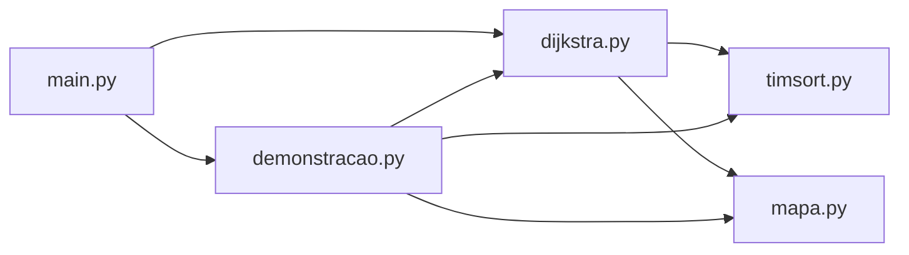

# TimSort + Dijkstra: rotas de entrega

Implementação manual do TimSort usada dentro do algoritmo de Dijkstra para calcular a rota mais curta de um motoboy, do restaurante até cada ponto de entrega. Feito para o seminário de algoritmos da Professora Paula Fernanda.

Só Python 3, sem bibliotecas externas.

## O que o programa faz

`python3 main.py` roda cinco etapas em sequência:

1. **Demonstração do TimSort**: ordena uma lista de arestas por distância com a implementação manual e compara com o `sorted()` do Python (que também é TimSort).
2. **Dijkstra passo a passo**: imprime cada nó visitado, os vizinhos já ordenados pelo TimSort e as distâncias atualizadas.
3. **Resultado**: menor distância e caminho completo de `R` (restaurante) até cada ponto.
4. **Prova real**: soma à mão os caminhos possíveis de `R` até `D`, acha o menor e confere com o Dijkstra.
5. **Benchmark**: tempo do TimSort manual contra o `sorted()` em listas aleatórias de 100, 500 e 1000 elementos.

## Como funciona



- **`timsort.py`**: divide a lista em blocos de `MIN_RUN` (32) elementos, ordena cada bloco com Insertion Sort e depois junta os blocos com merges de tamanho dobrado (32, 64, 128...). Aceita uma função `chave`, como o `key` do `sorted()`.
- **`dijkstra.py`**: a cada passo escolhe o nó não visitado de menor distância (busca linear, sem heap), ordena os vizinhos dele com o TimSort e relaxa as arestas. Guarda o nó anterior de cada um para reconstruir o caminho.
- **`mapa.py`**: o grafo como lista de adjacência, `{'R': [('A', 3), ('B', 2)], ...}`.
- **`demonstracao.py`**: demonstração, prova real e benchmark.

Ordenar os vizinhos não muda o resultado do Dijkstra (a escolha do próximo nó é sempre pelo menor custo acumulado); serve para mostrar o TimSort num uso real e deixar o log mais legível, com as arestas mais curtas primeiro.

### Mapa da cidade

```
        R ----3---- A ----4---- E
        |          /|           |
        2        5  2           1
        |      /    |           |
        B ---6---- C ----3---- D
         \                     |
          2                    5
           \                   |
             F -------7------- G
```

Cada letra é um cruzamento; os números são distâncias em km. Para testar outro cenário, edite `MAPA_CIDADE` em `mapa.py` (cada aresta precisa aparecer nos dois sentidos).

## Como rodar

```bash
python3 main.py
```

Saída (trechos):

```
=======================================================
  RESULTADO — partindo de 'R'
=======================================================
  Destino    Distância      Caminho
  ------------------------------------------------
  A          3              R → A
  B          2              R → B
  C          5              R → A → C
  D          8              R → A → C → D
  E          7              R → A → E
  F          4              R → B → F
  G          11             R → B → F → G

=======================================================
  PROVA REAL — verificação manual de R → D
=======================================================
  ...
  Menor manual: 8 km
    → R → A → C → D
    → R → A → E → D

  Dijkstra: 8 km | R → A → C → D

  ✅ PROVA REAL APROVADA — resultado correto!

=======================================================
  BENCHMARK — TimSort manual vs sorted() Python
=======================================================

  n=1000:
    TimSort manual: 1.728 ms
    sorted() Python: 0.140 ms
    (Python é mais rápido pois está implementado em C)
```

Os tempos do benchmark variam a cada execução e de máquina para máquina.

## Complexidade

| Algoritmo | Melhor caso | Médio | Pior caso |
|---|---|---|---|
| TimSort do Python (`sorted()`, detecta runs naturais) | O(n) | O(n log n) | O(n log n) |
| TimSort didático (este projeto, blocos fixos de 32) | O(n log n) | O(n log n) | O(n log n) |
| Dijkstra com busca linear (este projeto) | O(V²) | O(V²) | O(V²) |
| Dijkstra com heap (referência) | O((V+E) log V) | O((V+E) log V) | O((V+E) log V) |

V = número de vértices, E = número de arestas. Ordenar os vizinhos de cada nó soma O(E log d), onde d é o grau máximo.

## Estrutura

```
.
├── main.py           # ponto de entrada, roda as 5 etapas
├── timsort.py        # insertion_sort, merge, timsort
├── dijkstra.py       # dijkstra, reconstruir_caminho, imprimir_resultado
├── mapa.py           # grafo da cidade
└── demonstracao.py   # demonstração, prova real e benchmark
```
